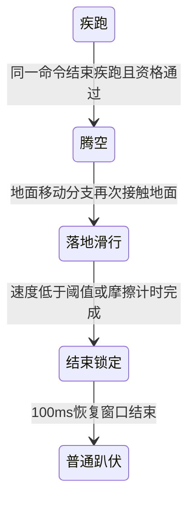

# 原生飞扑机制（3.3.3.3）

结论来自本版客户端的静态指令、字段表及已有的真实武器采集。飞扑是一条由疾跑退出、起扑、腾空、落地滑行、强制趴伏恢复及武器三阶段共同构成的预测状态链。Rust已接入默认参数下的移动、武器状态、快照和回放链，自动回归通过。固定3.3.3.3原生客户端在Killhouse平地完成主武器、M9及空仓主武器验收；同命令有效样本的移动、阶段时钟及持枪动作吻合。声音、第三人称动作和特殊地形不在本轮通过范围内。

研究样本为 `CODOL/codoMP_client_shipRetail.exe`，SHA-256：
`e3823fd6afc80fb25fa84747e6e9634707b9a0b189357a5466921cda354af37b`。
下文地址均为该 PE 的 VA，ImageBase 为 `0x400000`；RVA 为 VA 减去 ImageBase。
机器可读的参数、地址和字段索引见
[`fixtures/protocol/dive-3.3.3.3.json`](../fixtures/protocol/dive-3.3.3.3.json)。

## 输入与起扑条件

本版 `0x45ec00` 将客户端姿态3写成 `buttons |= 0x00800000 | 0x100`：同时请求飞扑和趴下。
`0x45ec50` 的按住趴下分支也会调用 `0x45e7f0`，满足条件时发出相同组合。
该辅助条件检查预测疾跑位 `0x4000`，以及当前视高不低于 `trunc(PS+0x98的体型倍率×60)`。
`0xc85910` 的double常数是60.0，普通站立视高生产函数 `0x4124d0` 也使用这一公式。
`0x45eb80` 的姿态长按分支在此条件成立时使用200ms门槛，否则为300ms；这只是该绑定分支的输入识别时间，不是服务端助跑时间，也不是所有趴下绑定统一需要长按200ms。

`PM_WalkMove 0x4174c0` 先检查普通跳跃，跳跃未触发后才调用飞扑检查 `0x40e1f0`。
后者通过 `0x40e0e0` 判断资格。默认参数下，首次起扑须同时满足：

- 飞扑总开关 dvar `2332` 开启。
- 当前 WeaponDef 的 `+0xd88` 为0；普通趴下检查 `0x418ec0` 也消费该禁止趴下字段。
- `lastSprintEnd == 当前正在模拟的 cmd.serverTime`，即本条命令刚退出疾跑。
- `pm_flags & 0x02000000 == 0`，且命令携带 `0x00800000`。
- 水平速度平方严格大于 `3.16²`。
- 水平速度单位向量与 `PS+0x150` 视角 yaw 的前向单位向量点积至少为 `0.98`，约对应左右11.48°。
- 距上次飞扑结束严格超过1500ms；原生代码也允许有符号时间差为负的分支。
- 距本次疾跑开始严格超过250ms。

朝向点积来自本版新增的 dvar `2783`，不能从 Alpha 实现中省略。斜向移动、急转身、把命令换成最新收包时钟，都可能改变资格判定。
落地状态和普通移动模式由上游分派约束，不应在任意空中命令上单独调用起扑判断。

## 移动状态链



**起扑 `0x40dca0`**

保留水平速度，单独写入垂直速度：

```text
height = 39
若原生 modMultiplyJumpHeight（能力表ID53）生效：
    height = 39 × 该能力当前参数
vz = sqrt(gravity × height)
若 dvar 2343 开启：vz *= dvar 2344（默认1.5）
```

默认重力800时 `vz≈264.953` 游戏单位/秒。这里没有额外向前冲量。
同时设置 `groundEntityNum=2047`、`jumpTime=now`、`jumpOriginZ=origin.z` 和
`PMF_DIVETOPRONE=0x40000000`，清除 `pm_flags` 的 `0x2180` 和 `pm_time`，发出起扑事件150。

**腾空 `0x417180 → 0x40dfe0`**

飞扑走原生 AirMove，仍消费前后／左右输入。
超过起点加上述 `height` 后，若距起扑尚不足400ms，将 `vz` 写成0；之后只钳制正的 `vz`。
400ms从起扑时刻计算，39是进入这条分支的高度阈值；代码不把 `origin.z` 直接固定在39，因此不能把它理解为精确最高点或额外悬停400ms。
dvar `2343` 控制这条高度处理，与起扑倍率使用同一个开关。

**接地 `0x40e1f0`**

第一次在地面分支看到仍为正的 `jumpTime`，写入 `jumpTime=-now` 并发出落地事件151。
飞扑位继续保留，后续仍走 AirMove；接地标志仍供地面摩擦使用。
`jumpTime` 的正负承担飞扑阶段含义，不能只按普通非负跳跃时钟处理。

**滑行 `0x416390 → 0x40de90`**

`elapsed = now + jumpTime`，由于 `jumpTime=-落地时间`，此时得到落地后毫秒数。
普通路径在300ms内按 `elapsed/300` 缩放地面摩擦，初始摩擦很小、随后恢复。
原生还用当前包围盒从 `origin.z+1` 向 `origin.z-1` 做 mask `0x01000000` 的检测；
命中且未到 `2334+2335` 时，摩擦倍率为0。该特殊内容的完整地形语义仍需验证。
这不是全地形绝对300ms的定时器：只有实际执行该摩擦分支时才推进相应结束处理。

**结束 `0x40ddf0`／`0x40de90`**

滑行阶段三维速度平方严格小于 `3.16²` 时提前结束；摩擦分支计时完成也会结束。
清除飞扑位、三轴速度和 `jumpTime`，记录 `diveEndTime=now`，清除疾跑松键要求。
`0x419270` 的姿态分支在飞扑期间及结束后100ms强制趴下并重写姿态按钮。
`PmoveSingle 0x41df18..0x41df5a` 仅在结束后的100ms窗口清除移动输入；腾空和滑行期间没有这项统一清除。
`0x40dd80` 是链接状态的中止路径，会回拨结束时间，绕过正常100ms锁定。

## 武器动作与恢复

本版武器状态为 `31（扑入）→32（循环）→33（恢复）→0`。

| 阶段 | 原生函数 | 计时／动画 |
| --- | --- | --- |
| 扑入 | `0x428550` | WeaponDef `+0x784`；普通弹匣动画35，空仓38 |
| 循环 | `0x428730` | 计时0；普通36，空仓39 |
| 恢复 | `0x428640` | WeaponDef `+0x78c`；普通37，空仓40 |
| 阶段分派 | `0x428df0` | 31到期进入32；32在滑行开始或飞扑位清除时进入33；33到期经 `0x427440` 恢复 |

`0x428af0` 在当前命令选有武器、飞扑位有效且尚未滑行时接管武器动作；
切枪／抬枪、射击／拉栓、近战、offhand及已有飞扑阶段会阻止该入口，换弹和疾跑阶段可以被接管。
`0x424fa0` 明确在31至33阶段拒绝切枪。完整按键打断矩阵仍需结合运行命令验收。

恢复动作可以在落地滑行开始时启动，不必等移动飞扑整体结束。
动画重启位为 `0x400`；双持槽按 `0x1c` 步长同步阶段，并按各手弹匣状态选择普通／空仓动画。

已有阿富汗真实采集含194份基础WeaponDef，读取本版字段得到：

| 基础武器 | 扑入ms | 恢复ms | 禁止趴下 |
| --- | ---: | ---: | ---: |
| M4 / AK47 / MG4 / 十字弩 | 150 | 250 | 0 |
| M9 | 79 | 360 | 0 |
| 防暴盾 | 500 | 500 | 1 |

其中139份为150/250，21份为150/360，21份为79/360；另有250/250、449/449、500/500各一份及0/0十份。
这些是基础定义的采集值，不能替代玩家实际配件组合结果，也不能把盾牌的500/500写成通用时间。
采集文件和各示例定义的SHA-256见JSON索引，原始客户端数据留在忽略目录。

## 落地伤害、事件与同步字段

`PM_CrashLand 0x417e30` 调用 `0x40dc10`：飞扑使用独立的等效落高伤害区间。
默认 `height<=65` 为0，`height>=200` 为100，中间按 `(height-65)/135×100` 截断到整数。
这是普通落地能量计算后的伤害百分比覆盖，完整效果还受既有判伤／能力／地面流程影响。
普通跳落的128至300区间不能直接用于飞扑；飞扑也不意味着免摔伤。

本版事件表 `0xce4390` 确认 `EV_DTP_LAUNCH=150`、`EV_DTP_LAND=151`，
参数位宽表 `0xc56d70` 确认两者均为5位。参数由 `0xcda1a8` 的31项地面材质映射表产生。
客户端还包含 `fly_dtp_launch_*`、`fly_dtp_land_*`、`fly_dtp_slide_loop_*` 声音名，
以及 `DTP_TAKEOFF`、`DTP_LAND`、`DTP_MOVE` 动作标识；仅发现名字不能视为第三人称动作及音效已接通。

| 内容 | 本版PS偏移 | 字段索引（从0开始）／编码 |
| --- | --- | --- |
| pm_flags | `+0xc` | 20／32位 |
| jumpTime（有符号阶段时钟） | `+0xbc` | 102／32位 |
| jumpOriginZ | `+0xc0` | 114／float |
| diveEndTime | `+0x238` | 37／-97时间编码 |
| 疾跑开始／结束 | `+0x244/+0x248` | 35／36，均为-97 |
| weapAnim | `+0x26c` | 9／11位 |
| weaponTime / weaponDelay | `+0x270/+0x274` | 3／44，均为-16 |
| weaponstate | `+0x27c` | 17／6位 |

这些字段须对应同一个正在模拟的命令。Alpha的事件185/186、`diveEndTime +0x234`、
WeaponDef `+0x630/+0x638` 和其默认武器时长均不能直接用于本版。

## Rust接入与验证状态

- `game/player/movement/dive.rs`按正在执行的移动子步判断疾跑退出、助跑／冷却、方向与武器门槛，保留水平速度，推进腾空、接地滑行、低速结束及100ms锁定。飞扑空中使用本版AirMove的速度缩放和速度取整。
- 武器从实际配件组合后的WeaponDef读取`+0x784/+0x78c/+0xd88`，按31／32／33推进并选择普通／空仓动作。换弹被接管时不转移弹药。长命令按移动子步向武器提供阶段，避免一次命令跨过接地而漏掉恢复。
- `MotionSnapshot`发布字段37。`jump_time`保留32位原始补码，负值按有符号落地时间解释；快照验证检查阶段／时钟一致性，回放分别平移正起扑时间、负落地时间及结束时间。
- 地面摩擦支持独立`0x01000000`胶囊扫掠，资源导出也保留该类几何。胶囊扫掠间隙使用本版`0x586810/0x58bb50`消费的`0xc855d0`双精度常数0.125；接地滑行保留AirMove的贴地裁剪及StepSlide处理。现有仅按旧mask采集的地图尚不能证明特殊滑行材质覆盖完整。
- 飞扑使用独立落地伤害区间；单人Bot连接和共享真人世界均接入移动事件及武器阶段，死亡、重生及冻结路径清理飞扑状态。

自动回归覆盖时间／朝向边界、实际阿富汗M4和M9组合武器参数、腾空／滑行／恢复、特殊内容mask、长命令、共享世界、伤害和回放时钟。独立接入版本通过661项Rust测试、169项Python测试、格式、严格Clippy及架构检查；真实阿富汗资源的60秒离线地图检查通过，11个Bot移动并产生5次击杀。

原生验收使用固定EXE、独立账号数据和Killhouse真实碰撞资源，通过普通疾跑／趴下输入触发：

| 用例 | 采样帧 | 飞扑帧（腾空／滑行） | 扑入／恢复ms | 飞扑期间弹匣 | 动画 |
| --- | ---: | ---: | ---: | ---: | --- |
| 主武器 | 400 | 41（28／13） | 150／250 | 30 | 35／36／37 |
| M9 | 400 | 45（33／12） | 79／360 | 15 | 35／36／37 |
| 空仓主武器 | 400 | 39（26／13） | 150／250 | 0 | 38／39／40 |

三组均观察到正起扑时钟、负落地时钟、31→32→33→就绪、事件150／151及飞扑期间弹量不变；两组非空仓用例恢复后可正常开火。空仓在实际射击打空后立即触发飞扑，未改写客户端内存或武器资源。

同命令比对排除读取期间变化、死亡、回放、其它客户端、不同重生次数及预测回放中的旧命令，并按采样时间范围关联权威快照。获得16个腾空、6个滑行有效样本，最大位置误差约0.019游戏单位，速度误差为0，正负阶段时钟一致。这22个样本的结论只覆盖该平地路线；不能将1200个采样帧全部算作有效位置比对。

原始采样、快照索引和逐样本结果见`research-output/dive-integration-proof/native-acceptance.json`，各采样SHA-256及计数已登记到JSON参数索引。客户端实验已结束，临时证书信任已恢复。

仍待扩展原生验收：墙角、坡地、台阶／边缘、特殊滑行内容、方向切换、不同输入绑定、能力53高度倍率、死亡／重生及回放。双持专用武器链、第三人称动作生产、声音消费及动态飞扑dvar改写尚未完成核对，不由本轮平地验收替代。

## 证据与复现

静态原始材料：`research-output/dive-3333-{movement,weapon,input}.asm`、
`research-output/ghidra/dive-3333-{core,state,lockout,weapon,input,weapon-dispatch}.c`，
已有武器采集摘要为 `research-output/dive-3333-weapon-metadata.json`。
反编译对x86寄存器传参及x87浮点返回有缺失，关键比较、公式和返回倍率已核对原始指令；
中途调用地址的部分反编译不能当作完整函数。

在 `server/` 内可复查资格函数原始指令：

```sh
.venv/bin/python tools/analyze.py native --rva 0xe0e0 --size 0x110
```

完整状态函数反编译使用现有只读Ghidra工程，不执行游戏：

```sh
.tools/ghidra/ghidra_12.1.4_PUBLIC/support/analyzeHeadless \
  research-output/ghidra codol3333 \
  -process codoMP_client_shipRetail.exe -readOnly -noanalysis \
  -scriptPath tools/ghidra \
  -postScript DecompileTargets.java research-output/ghidra/dive-3333-state.c \
  0x40d900 0x40dbe0 0x40dc10 0x40dca0 0x40dd80 0x40ddf0 \
  0x40de90 0x40dfe0 0x40e090 0x40e0e0 0x40e1f0
```

静态核验覆盖EXE指纹、dvar默认常数、调用指令、事件名字／位宽／材质表和PS字段表；
未将Alpha的历史trace或本版其它动作的运行记录计为本版飞扑验收。
